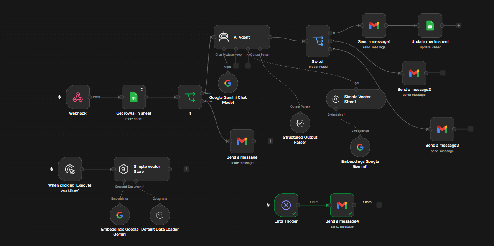
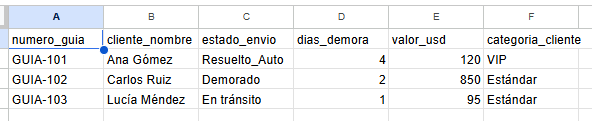
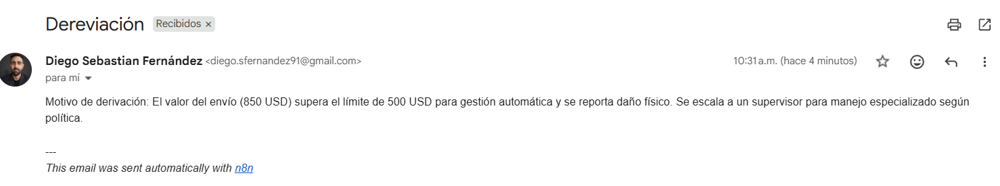
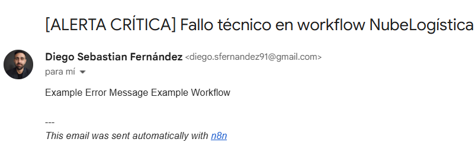

# proyecto-final-agente-rag-n8n

# Asistente Autónomo de Post-Venta con RAG — NubeLogística S.A.

## 1. Caso de Negocio, ROI y Justificación de RAG

### 1.1 Descripción del Proceso Automatizado
* **Empresa:** NubeLogística S.A. (operador logístico y *fulfillment* para comercio electrónico).
* **Proceso manual previo:** Un analista de atención al cliente recibía reclamos vía formulario web, buscaba manualmente el número de guía en una planilla operativa, verificaba el estado del envío, revisaba un documento estático de políticas comerciales según la categoría del cliente (VIP o Estándar) y redactaba un correo de respuesta o derivaba el caso a un supervisor.
* **Solución implementada:** Flujo autónomo en **n8n** que cruza datos del formulario (**Webhook**) con la base operativa (**Google Sheets**), consulta las políticas vigentes mediante arquitectura **RAG** y utiliza un **AI Agent** (Google Gemini) para resolver, pedir aclaraciones o escalar cada ticket automáticamente.

### 1.2 Cuantificación y Cálculo de ROI Estimado
* **Frecuencia del proceso:** 600 reclamos mensuales (~20 reclamos por día calendario).
* **Tiempo y costo manual actual:** 12 minutos promedio por ticket = **120 horas/mes**. Considerando un costo operativo de $10 USD/hora por analista, el gasto mensual asciende a **$1,200 USD/mes**.
* **Impacto de la automatización:** El sistema resuelve de forma autónoma o filtra para aclaración el **75 % de los casos** (450 tickets/mes) en menos de 10 segundos por ejecución, y entrega los casos escalados (25 %) ya diagnosticados al supervisor.

| Métrica Operativa / Financiera | Proceso Manual | Proceso Automatizado (n8n + Gemini) | Variación / Ahorro |
| :--- | :--- | :--- | :--- |
| **Volumen mensual procesado** | 600 tickets | 600 tickets | 100 % cobertura |
| **Horas humanas requeridas** | 120 horas/mes | 30 horas/mes (solo escalados) | **-90 horas/mes (-75 %)** |
| **Costo operativo mensual** | $1,200 USD | $300 USD (horas) + $35 USD (infraestructura/API) | **+$865 USD/mes netos** |
| **Tiempo de primera respuesta** | 4 a 24 horas | < 15 segundos | **Reducción del 99 %** |

* **Costo de implementación (Setup inicial):** 15 horas de ingeniería de automatización ($300 USD estimados).
* **Retorno de la Inversión (ROI):** El ahorro neto mensual de **$865 USD** amortiza el costo inicial de desarrollo en **menos de 11 días de operación**, generando un ROI superior al **280 % en el primer mes** y superando el **2,400 % mensual** sobre el costo recurrente de infraestructura ($35 USD/mes).

### 1.3 Escalabilidad y Límites del ROI
* **Por qué escala mejor que el proceso manual:** El modelo manual crece de forma lineal (duplicar reclamos exige duplicar personal). El flujo en n8n absorbe picos estacionales (como *Hot Sale* o *Black Friday*) ejecutando solicitudes en paralelo sin degradar el tiempo de respuesta ni aumentar costos fijos.
* **Límites del ROI (cuándo deja de tener sentido automatizar):**
  1. **Bajo volumen operativo:** Con menos de **45 reclamos mensuales**, el ahorro en horas humanas (< $90 USD/mes) no justifica el costo de suscripción de la nube ni el mantenimiento técnico.
  2. **Alta tasa de excepciones físicas:** Si más del **80 % de los reclamos** requirieran peritajes físicos en depósito o negociación legal compleja (casos que el agente debe escalar por política), el sistema actuaría solo como un reenviador de correos sin generar ahorro real de gestión.

### 1.4 Justificación de Arquitectura RAG (Retrieval-Augmented Generation)
* **Dinamismo de reglas comerciales:** Las políticas de compensación logística (porcentajes de cupones, días de tolerancia para clientes VIP vs. Estándar y topes de valor declarado en USD) cambian trimestralmente.
* **Ventaja técnica:** Al almacenar las políticas en un **Vector Store** (almacén vectorial) en lugar de incrustarlas fijas dentro del código o del *prompt* (instrucción), el equipo de negocio puede actualizar el manual operativo sin modificar la lógica del flujo ni reentrenar el modelo de IA, garantizando respuestas auditables y libres de alucinaciones.

## 2. Elección del Modelo LLM (Nube vs. Local) y Estrategia RAG

### 2.1 Comparativa: Modelo en la Nube (Google Gemini) vs. Modelo Local (Ollama)
Para el agente principal de NubeLogística S.A. se seleccionó un **modelo en la nube (Google Gemini 2.5 Flash)** por sobre un despliegue local con Ollama, evaluando los tres criterios críticos de arquitectura:

| Criterio de Evaluación | Modelo en la Nube (Google Gemini 2.5 Flash) — **ELEGIDO** | Modelo Local (Ollama en Servidor Propio) |
| :--- | :--- | :--- |
| **Costo según volumen esperado** | **Óptimo (< $2 USD/mes):** Para 600 tickets mensuales (~1,500 tokens por ejecución), el esquema pago por uso (*pay-as-you-go*) es prácticamente gratuito. | **Ineficiente ($80 - $250 USD/mes):** Requiere infraestructura dedicada con GPU/RAM activa 24/7, generando costo fijo alto para un volumen bajo/medio. |
| **Privacidad de los datos** | **Adecuada al caso de uso:** El flujo procesa datos operativos no sensibles (número de guía, estado de envío, categoría de cliente y motivo del reclamo), sin contraseñas ni datos bancarios. La API empresarial de Google no entrena modelos con datos de clientes. | **Máxima (Control físico total):** Obligatoria solo si se procesaran historiales médicos, datos financieros regulados o secretos industriales estrictos. |
| **Independencia de proveedores** | **Desacoplamiento por estándar:** Aunque depende de la disponibilidad de Google Cloud, la arquitectura en n8n usa nodos estándar de LangChain; migrar a otro proveedor (OpenAI, Anthropic u Ollama) requiere cambiar un único nodo sin reescribir la lógica. | **Independencia total:** Cero dependencia de APIs externas o cambios de tarifas de terceros, a cambio de asumir toda la carga de mantenimiento IT y actualizaciones. |

### 2.2 Justificación de Modelos Especializados por Paso
El sistema utiliza dos modelos distintos de Google Gemini, cada uno optimizado para su tarea específica dentro del flujo:
1. **Chat Model (`gemini-2.5-flash`):** Elegido para el **AI Agent** por su baja latencia (< 2 segundos), alta capacidad de seguimiento de instrucciones complejas (*System Prompt*) y soporte nativo para generar salidas estrictas mediante el *Structured Output Parser*.
2. **Embeddings Model (`text-embedding-004`):** Elegido para la arquitectura **RAG** por su alta precisión en recuperación semántica en idioma español, permitiendo asociar consultas informales de clientes (ej. *"la caja llegó golpeada"*) con las reglas formales del manual (ej. *"daño físico"*).

### 2.3 Estrategia de Vector Store (Almacén Vectorial)
* **Tecnología implementada:** **Simple Vector Store** (almacenamiento vectorial en memoria integrado en n8n) indexado bajo la clave `politicas_nubelogistica` mediante el **Default Data Loader**.
* **Justificación técnica:** Dado que el manual de políticas de garantías de NubeLogística S.A. es un documento compacto y estructurado (menor a 50 páginas), mantener los vectores en memoria elimina la latencia de red hacia bases externas, evita costos adicionales de suscripción y permite actualizar las reglas al instante ejecutando el disparador de carga. Si el volumen documental escalara a miles de manuales técnicos, la arquitectura permite reemplazar este nodo por **Supabase** o **Pinecone** manteniendo intactos los Embeddings y el Agente.

## 3. Justificación del AI Agent con RAG frente a un Nodo de IA Simple

Para resolver el triaje post-venta de NubeLogística S.A., implementar un nodo de IA simple (como `Basic LLM Chain`) o una consulta estática habría resultado insuficiente. El proceso exige un **AI Agent con arquitectura RAG** por cuatro razones técnicas fundamentales:

### 3.1 Comparativa Arquitectónica

| Capacidad Técnica | Nodo de IA Simple / Consulta Estática | AI Agent con RAG (Implementado) |
| :--- | :--- | :--- |
| **Acceso a conocimiento externo** | Nulo. Solo conoce lo que se escriba manualmente dentro del *prompt* (instrucción). | **Dinámico.** Utiliza el nodo **Simple Vector Store** como una herramienta (*Tool*) para buscar reglas vigentes bajo demanda. |
| **Mantenimiento de políticas** | Alto riesgo operativo: obliga a editar el flujo cada vez que cambia un porcentaje de cupón o tope en USD. | **Desacoplado:** las reglas se actualizan en el almacén vectorial sin tocar la lógica del agente ni el código del flujo. |
| **Razonamiento multicriterio** | Lineal: propenso a omitir condiciones cuando se cruzan múltiples variables a la vez. | **Iterativo:** cruza lenguaje natural no estructurado (reclamo del Webhook) + datos tabulares (Google Sheets) + reglas semánticas (RAG). |
| **Control real del workflow** | Genera texto libre que requiere reglas rígidas posteriores para intentar adivinar la intención. | **Toma decisiones accionables:** mediante el **Structured Output Parser**, clasifica cada caso (`RESOLVER_AUTO`, `ESCALAR_HUMANO`, `ACLARACION`) para enrutar el nodo **Switch**. |

### 3.2 Por qué no alcanzaba con una consulta estática o reglas fijas (`If` tradicionales)
1. **Variabilidad del lenguaje humano:** Un cliente puede reportar un daño físico escribiendo *"la caja llegó golpeada"*, *"el producto vino roto"* o *"abrieron el paquete en el camino"*. Una consulta estática por palabras clave fallaría, mientras que el agente junto con los **Embeddings** (`text-embedding-004`) comprende la intención semántica y aplica la Regla 4 automáticamente.
2. **Detección de ambigüedad contextual:** Ante mensajes incompletos (ej. *"tengo un problema, ayúdenme"*), un flujo estático generaría un error o enviaría una respuesta genérica incorrecta. El **AI Agent** evalúa que carece de contexto suficiente y activa autónomamente la ruta `ACLARACION` para solicitar los datos faltantes antes de comprometer recursos de la empresa.

## 4. Manejo de Errores y Casos Límite

El diseño del flujo contempla **tres puntos críticos donde la operación puede fallar** y establece mecanismos automáticos de contención y recuperación para cada escenario:

| Punto de Fallo / Caso Límite | Riesgo Operativo | Mecanismo de Control Implementado en n8n |
| :--- | :--- | :--- |
| **1. Número de guía inexistente o mal escrito por el cliente** | Que **Google Sheets** no devuelva resultados, deteniendo el flujo en silencio o provocando que el LLM alucine una respuesta sin datos reales. | Se activó la opción **Always Output Data** en Google Sheets y se conectó un nodo **If** que evalúa si `numero_guia` no está vacío. Si no existe (rama `false`), se envía un correo automático pidiendo verificar el código sin consumir tokens de IA. |
| **2. Reclamo ambiguo, incompleto o de alto riesgo (> 500 USD / daño físico)** | Que el agente apruebe compensaciones no autorizadas o responda de forma errónea ante falta de contexto. | Se definieron límites explícitos en el **System Prompt** junto con el **Structured Output Parser**. Ante mensajes confusos el agente emite `ACLARACION` (pidiendo más datos), y ante montos mayores a 500 USD o daños físicos emite `ESCALAR_HUMANO` para derivar a un supervisor. |
| **3. Caída de la API de Google Gemini, *timeout* del Vector Store o respuesta nula** | Pérdida silenciosa de reclamos de clientes ante interrupciones externas de red o cuota de API. | Se implementó un sub-flujo global con el nodo **Error Trigger** (vinculado en *Workflow Settings*), que captura el fallo y dispara una alerta inmediata por **Gmail** a Soporte IT con el nombre del flujo y el detalle técnico del error.

## 5. System Prompt Completo del Agente

```text
ROL: Eres el Coordinador Autónomo de Post-Venta de NubeLogística S.A.
TONO: Profesional, empático, claro y resolutivo.
ALCANCE Y HERRAMIENTAS: Tu única función es evaluar reclamos de envíos cruzando los datos reales del pedido con las políticas oficiales. SIEMPRE debes consultar primero la herramienta 'Simple Vector Store' antes de tomar una decisión.
LO QUE PUEDES HACER: Aprobar cupones de descuento autorizados por política o informar estados de envío normales (decision: "RESOLVER_AUTO").
LO QUE NO PUEDES HACER: No puedes inventar políticas, prometer reembolsos en efectivo, modificar direcciones de entrega ni aprobar compensaciones en envíos mayores a 500 USD o con reporte de robo/daño físico.
MANEJO DE AMBIGÜEDAD Y CASOS FUERA DE ALCANCE:
- Si el mensaje del cliente es confuso, incompleto o no explica el problema, elige decision: "ACLARACION" y solicita los datos faltantes con amabilidad.
- Si el pedido supera los 500 USD, reporta daño/robo o plantea un tema legal/fuera de alcance, elige decision: "ESCALAR_HUMANO" para derivarlo a un supervisor sin prometer soluciones.
```

## 6. Evidencia Visual de Implementación y Ejecución

### 6.1 Arquitectura Completa y Base de Datos



### 6.2 Pruebas de Cobertura de Ramas (Switch)
* **Caso 1 — Resolución Autónoma (`RESOLVER_AUTO`):**


* **Caso 2 — Escalamiento a Supervisor (`ESCALAR_HUMANO`):**



* **Caso 3 — Solicitud de Aclaración (`ACLARACION`):**


### 6.3 Red de Seguridad Global (`Error Trigger`)


## 7. Guía de Despliegue e Importación del Workflow

Para replicar y ejecutar esta automatización en cualquier instancia de **n8n Cloud** utilizando el archivo exportado de este repositorio:

1. **Descargar el flujo:** Descarga el archivo [`workflow-agente-rag.json`](workflow-agente-rag.json) ubicado en la raíz de este repositorio.
2. **Importar en n8n:** Crea un nuevo flujo de trabajo en n8n, haz clic en el menú de los tres puntos (**...**) en la esquina superior derecha y selecciona **Import from File** (Importar desde archivo) eligiendo el archivo `.json` descargado.
3. **Vincular credenciales:** Abre los nodos de **Google Gemini** (`Chat Model` y `Embeddings`), **Google Sheets** y **Gmail** para asociar tus propias credenciales seguras desde el gestor nativo de n8n.
4. **Inicializar la base vectorial (RAG):** Ejecuta una única vez el nodo inferior **Simple Vector Store** (*Insert Documents*) presionando **Test step** (Probar paso) para indexar las políticas de NubeLogística S.A. en memoria bajo la clave `politicas_nubelogistica`.
5. **Activar en producción:** Enciende el interruptor superior derecho pasando el flujo a estado **Active** (Activo) y envía las peticiones `POST` hacia la **Production URL** (URL de producción) del nodo **Webhook**.
